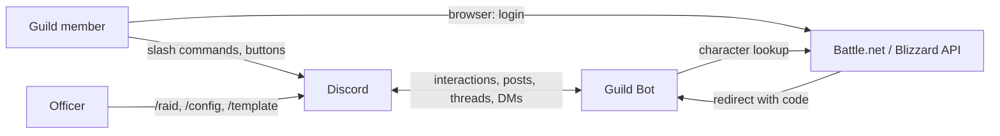
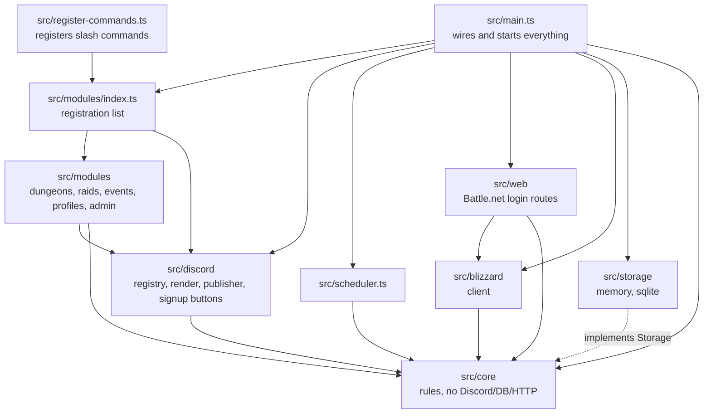
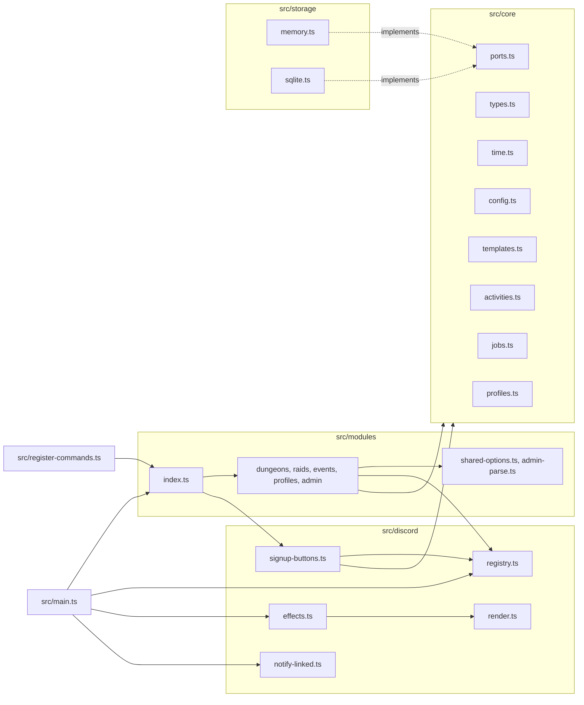
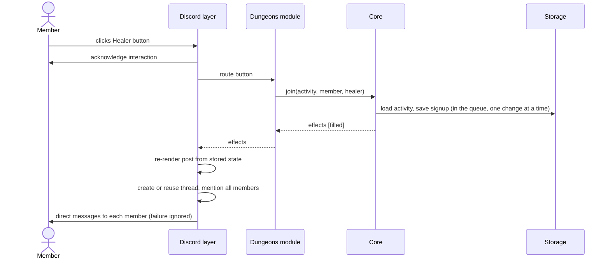
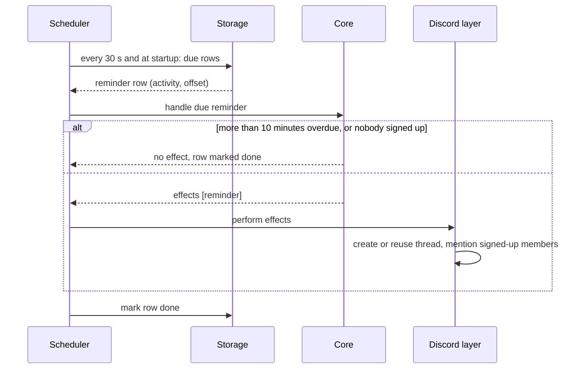
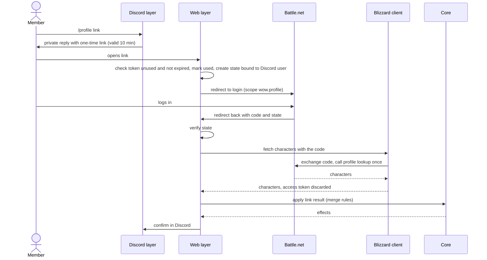
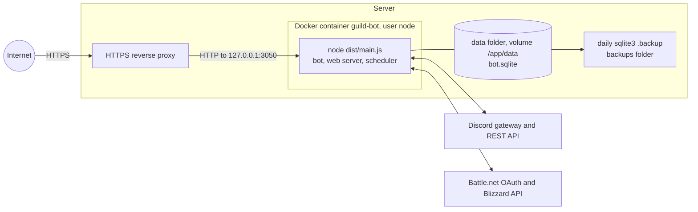

# Architecture: Guild Bot for WoW Forever

This document follows the arc42 template (12 sections). Requirements are in [req42](../requirements/req42.adoc). Items marked *(call)* were decided by the designer, not the project owner.

## 1. Introduction and Goals

### Requirements overview

A Discord bot for one World of Warcraft: Forever guild. It helps members find each other and play together:

- Dungeon finder: any member starts a group, others join by role, everyone is told when it is full.
- Raid finder: officers post raids, members sign up by role.
- Event planner: any member posts a free-form event.
- Character profiles: members link Battle.net to fetch their Forever characters, or enter them by hand.
- Officer commands for small, frequent changes (channels, officer roles, reminders, timezone, templates).

The full list is the product backlog in [req42 section 4](../requirements/req42.adoc).

### Quality goals

| Priority | Goal | Meaning |
|---|---|---|
| 1 | Changeability | New features are new modules. Rules live in a core that is tested without Discord. |
| 2 | Reliability of notifications | Full, promotion and reminder messages are not lost by a restart, a double click or a blocked direct message. |
| 3 | Privacy | Battle.net access tokens are never stored. Members can delete their data. Secrets stay in environment variables. |

### Stakeholders

| Stakeholder | Interest |
|---|---|
| Guild members | Quick group finding, clear notifications, optional profile. |
| Officers | Raids and small configuration changes from Discord. |
| Guild leadership | A bot that follows the guild's changing decisions. |
| Developer and maintainer | Easy extension, automated tests, simple deployment. |
| Blizzard, Discord | External platforms the bot depends on. |

## 2. Architecture Constraints

- Technology stack *(call)*: TypeScript on Node.js, discord.js, SQLite, Vitest, ESLint and Prettier, Docker, GitHub Actions. This is the designer's choice, not a constraint from the owner. The implementation plan fixes the details: Node.js 24 or newer, TypeScript strict, ESM with NodeNext, discord.js 14, better-sqlite3, luxon, zod.
- `src/core` imports no Discord, database or HTTP library and no other `src/` folder. A module in `src/modules` never imports another module.
- The bot speaks English only. There is no translation layer.
- The Forever character lookup is unofficial and may change (see section 3). Group finding must not depend on it.
- Battle.net login needs a public HTTPS address. The bot itself does not terminate HTTPS.
- Secrets are only passed through environment variables, validated at startup.
- Fixed sets: roles are exactly tank, healer, dps, participant. Activity kinds are exactly dungeon, raid, event.
- Documents (req42, arc42) are written before code and updated with every feature.

## 3. Context and Scope

### Business context

| Partner | Exchange |
|---|---|
| Members and officers | Use Discord only. Open one web link when linking Battle.net. |
| Discord | Interactions in. Posts, edits, threads, mentions and direct messages out. |
| Battle.net / Blizzard | OAuth login, then one lookup of the member's Forever characters. |

### Technical context

| Interface | Technology | Notes |
|---|---|---|
| Discord | discord.js 14, gateway connection and REST | Every interaction is acknowledged before other work (3-second limit). |
| Web (login) | Node HTTP server, two routes: start login from a one-time link, and the return step | Public HTTPS address provided by a reverse proxy in front of the web port. |
| Blizzard | HTTPS: OAuth authorize and token, then `GET https://{region}.api.blizzard.com/profile/user/wow?namespace=profile-forever-{region}` | Scope `wow.profile`. Region is a setting, default `eu`. Unofficial for Forever. The access token is used once and discarded. |
| Database | SQLite file through better-sqlite3 | One file on a persistent volume. |

## 4. Solution Strategy

| Goal | Approach |
|---|---|
| Changeability | A core with all rules, feature modules that plug into a registry, thin outer layers (ADR-1). One generic activity with templates instead of one code path per kind (ADR-2). |
| Cheap Discord-side changes | Dungeon and raid lists, templates, reminders, channels and officer roles are data changed with officer commands. |
| Reliable notifications | Core methods return a list of effects; the Discord layer performs them. Reminders and closing are database rows checked by a scheduler (ADR-5). Activity changes are applied one at a time by a single queue inside the bot process, not by a database transaction, so exactly one bot process may use a database. Posts are re-rendered from stored state. When no thread can be had, the mentions go out as replies to the post. |
| Testability | The core depends on two interfaces it defines (`Storage`, `Clock`) and receives fetched characters as plain data (`FetchedCharacter`). Tests use in-memory storage and a fake clock; the web layer is tested with a fake `BlizzardClient` and the Blizzard client with a fake `fetch`. The SQLite storage is tested against a temporary file. |
| Privacy | No stored Battle.net tokens, one-time random links, state value bound to the Discord user, `/profile remove` deletes data (ADR-4). |
| Resilience to Blizzard changes | The Blizzard client is the only code that knows the lookup, and manual profiles are always possible (ADR-4). |

## 5. Building Block View

### Level 1: layers

Dependencies point inward: the outer layers use the core, and the core knows only the interfaces it defines. `src/main.ts` is the only file that knows every part.

Arrows mean "imports". `src/env.ts` (configuration) and `src/log.ts` (logging) are used by the outer layers and left out of the picture; the core imports neither.

| Building block | Responsibility | Interfaces |
|---|---|---|
| `src/core` | Activities, templates, slots, signups, waitlist promotion, lifecycle, reminder planning, permission rules, settings, profiles. Plain TypeScript. | Defines the `Storage` and `Clock` interfaces. Activity methods return an `ActivityResult`: the stored state plus a list of effects. Characters fetched from Battle.net arrive as plain data (`FetchedCharacter`). |
| `src/modules` | Feature modules: dungeons, raids, events, profiles, admin. Each declares its slash commands and handles its commands, autocomplete, buttons and forms by calling the core. Helpers shared by several modules live in `shared-options.ts` and `admin-parse.ts`. No module imports another. | Each exports a `BotModule` (defined in `src/discord/registry.ts`). `index.ts` is the registration list: the single place a feature is registered, and the only file that imports all modules. |
| `src/discord` | discord.js. `registry.ts` routes commands and autocomplete by command name, and buttons, menus and forms by custom-id prefix. `render.ts` builds every post from stored state. `effects.ts` is the publisher: it turns an `ActivityResult` into a post, a post edit, thread messages, mentions and direct messages. `signup-buttons.ts` handles the buttons on every post. | `BotModule`, `Services`, `createRouter`, `createPublisher`. |
| `src/storage` | Implements `Storage`: in memory (tests) and SQLite with versioned migrations, applied at startup. | `Storage` of the core. |
| `src/web` | Minimal `node:http` server with two routes: `/link/:token` starts the Battle.net login, `/callback` finishes it. | Uses `ProfileService` and the Blizzard client. Reports a finished link through an `onLinked` callback, which `main.ts` sets to the direct message from `src/discord/notify-linked.ts`. |
| `src/blizzard` | Battle.net OAuth code exchange and the Forever character lookup. | Defines the `BlizzardClient` interface that the web layer uses. |
| `src/scheduler.ts` | Every 30 seconds, starting when the Discord client is ready: runs the due jobs through `ActivityService` and hands each result to the publisher. One failing job does not stop the others. | Core, clock, publisher (`onResult`). |
| `src/main.ts` | Composition root. Validates the environment, opens the SQLite storage, creates exactly one instance of each service, seeds the templates, connects to Discord with only the `Guilds` intent, starts the scheduler and the web server, and stops everything on `SIGTERM` or `SIGINT`. | Environment variables. |
| `src/register-commands.ts` | Registers the slash commands of every module in the registration list as guild commands (`npm run register`). | Discord REST API. |

The core emits these **effects**: `filled`, `refilled`, `promoted`, `starterChanged`, `timeChanged`, `cancelled`, `reminder`, `closed`.

### Level 2: files

This is the file structure as built. Paths are relative to the repository root.

| File | Responsibility |
|---|---|
| `src/env.ts` | Reads and validates environment variables at startup. |
| `src/log.ts` | Logger: one JSON object per line (`level`, `msg`, `time`, context); an error is written as its name, message and stack. Not used by the core. |
| `src/main.ts` | Composition root: creates the parts, starts them, and stops them on `SIGTERM` or `SIGINT`. |
| `src/register-commands.ts` | `npm run register`: registers every module's slash commands for the guild. |
| `src/core/types.ts` | Domain types and `UserError`. |
| `src/core/ports.ts` | `Storage` and `Clock` interfaces that the core needs. |
| `src/core/time.ts` | `parseTime`: typed time input in the guild timezone. |
| `src/core/config.ts` | `ConfigService`: settings and the officer rule. |
| `src/core/templates.ts` | `TemplateService`: add, edit, disable and seed templates. |
| `src/core/activities.ts` | `ActivityService`: signups, waitlist, lifecycle; returns effects. Its internal queue applies changes one at a time, so the process must hold exactly one instance. |
| `src/core/jobs.ts` | `planJobs`: plans reminder and closing jobs. |
| `src/core/profiles.ts` | `ProfileService`: one-time links, link results, manual characters, main character, removal. |
| `src/storage/memory.ts` | In-memory `Storage` for tests. |
| `src/storage/sqlite.ts` | SQLite `Storage`. |
| `src/storage/migrations/001_init.sql` | First database migration. |
| `src/scheduler.ts` | 30-second loop over due jobs. |
| `src/discord/registry.ts` | `BotModule` and `Services` interfaces, routing of commands, autocomplete, buttons, menus and forms, and the error reply. |
| `src/discord/render.ts` | Turns an activity of any kind into a message payload. |
| `src/discord/effects.ts` | The publisher: post, thread, mentions, direct messages. |
| `src/discord/signup-buttons.ts` | Shared handler for the buttons on every activity post. |
| `src/discord/notify-linked.ts` | The direct message listing a member's characters after a Battle.net link. |
| `src/modules/index.ts` | Registration list of all modules, read by `main.ts` and `register-commands.ts`. |
| `src/modules/{dungeons,raids,events,profiles,admin}.ts` | Feature modules: slash commands and their handlers. |
| `src/modules/shared-options.ts` | Shared by dungeons, raids and events: time and post options, the cancel and time subcommands, template choice and autocomplete, publishing a new post. |
| `src/modules/admin-parse.ts` | Reading and writing reminder offsets such as "24h, 1h, 15m". |
| `src/blizzard/client.ts` | OAuth exchange and Forever character lookup. |
| `src/web/server.ts` | The two routes `/link/:token` and `/callback`. |
| `seed/templates.json` | Initial dungeons and raids, added at startup only while the guild has no dungeon or raid template at all (disabled ones count), so a renamed or disabled seed template is never added again. `main` reads it as `../seed/templates.json`, so the same path works from `src/` and `dist/`. |
| `Dockerfile`, `.dockerignore` | The container image (section 7). |
| `docs/operations.md` | Setup, deployment, backup and the manual test checklist. |
| `tests/` | Vitest tests, mirroring `src/`. `tests/support/storage-contract.ts` runs the same storage tests against both storages. |

`src/discord/signup-buttons.ts` is itself a `BotModule` (custom-id prefix `act`) without slash commands. It lives in the Discord layer because it handles the buttons on every activity post, and it is registered through `src/modules/index.ts` like the feature modules. The feature modules do not import it and it does not import them, so there is no dependency cycle.

## 6. Runtime View

### Scenario 1: join a dungeon and fill it

If the role is full, the member goes on the waitlist and no `filled` effect is returned. When a member later leaves, the core promotes the first waitlisted member for that role and returns `promoted`; if the activity was full it is now open again, and when it fills again `refilled` produces a note in the thread only.

### Scenario 2: a reminder fires

The same loop handles automatic closing: expiry and finished rows produce a `closed` effect, and the Discord layer marks the post and removes its buttons.

### Scenario 3: Battle.net link

If the Battle.net account is already linked to another member, the link is refused with an explanation and nothing is stored. If the lookup fails, the member is told to use `/profile add`.

## 7. Deployment View

| Element | Notes |
|---|---|
| Image | `Dockerfile` with two stages on `node:24-slim`. The build stage installs python3, make and g++ (better-sqlite3 compiles its native part when no prebuilt binary matches), runs `npm ci` and `npm run build`, then removes the development dependencies. The runtime stage holds only the production `node_modules`, `dist/` and `seed/`, runs as the non-root user `node` (uid 1000), declares `VOLUME /app/data` and starts `node dist/main.js`. `.dockerignore` keeps `.env`, the data folder, tests and docs out of the image. |
| Container | One container, one process, and only one process per database: signups are put in order by a queue inside the process, so a second process on the same file could overfill a group. Configuration only through environment variables (`--env-file .env`): `DISCORD_TOKEN`, `DISCORD_APP_ID`, `GUILD_ID`, `DATABASE_PATH`, `PUBLIC_URL`, `PORT`, `BLIZZARD_CLIENT_ID`, `BLIZZARD_CLIENT_SECRET`, `BLIZZARD_REGION`, validated at startup. `docker stop` sends `SIGTERM`: the scheduler stops, the web server and the Discord connection close, then the database. |
| Volume | `/app/data`, a host folder owned by uid 1000. It holds `bot.sqlite` (WAL mode). Migrations run at startup. The host backs it up daily with `sqlite3 … ".backup …"`. |
| HTTPS | The web server speaks plain HTTP on `PORT` (default 3050), published on `127.0.0.1` only. A reverse proxy terminates HTTPS for `PUBLIC_URL` and forwards to it. Only `/link/:token` and `/callback` are served; the Battle.net redirect URL is `${PUBLIC_URL}/callback`. |
| Discord | Gateway connection with only the `Guilds` intent; posts, threads and direct messages go through the REST API. Slash commands are guild commands for `GUILD_ID`, registered with `npm run register` after each update. |
| Logs | stdout and stderr, one JSON object per line (`level`, `msg`, `time`, context), read with `docker logs`. Tokens, OAuth codes and secrets are never logged. An unhandled promise rejection is logged and the bot keeps running; an uncaught exception or a failed Discord login is logged and the process exits non-zero, and Docker's restart policy starts it again. |
| CI | GitHub Actions runs lint, type check and tests on every push. |

The host and the reverse proxy are the operator's choice. [docs/operations.md](../operations.md) describes one setup (Docker with Caddy) step by step, including the daily backup.

## 8. Cross-cutting Concepts

### Effects

Core methods do not talk to Discord. They change stored state and return a list of effects (`filled`, `refilled`, `promoted`, `starterChanged`, `timeChanged`, `cancelled`, `reminder`, `closed`). The Discord layer turns each effect into posts, thread messages, mentions and direct messages. This keeps rules testable without Discord and lets a new outer layer reuse them.

### UserError

Errors a member should see (for example "only officers can post raids", "could not read that time, try `today 20:30`") are thrown as `UserError` and shown as written. Every other error is logged and the member sees "Something went wrong." Every Discord interaction is acknowledged first, so the error is delivered as a follow-up.

### Serialised mutations

Every activity change (create, sign up, leave, cancel, change time, run a due job) goes through one queue inside `ActivityService`, which applies the changes one at a time. Two simultaneous clicks on the last slot cannot overfill it: one succeeds, the other is waitlisted. This is not a database transaction: SQLite transactions wrap only replacing an activity's jobs, deleting a member, taking a link token and the migrations. The queue exists only inside one process, so `main.ts` creates exactly one `ActivityService` and exactly one bot process may use a database; a second process on the same file could overfill a group.

### Re-render from state

A post is always built from stored state and never patched incrementally. If an edit to Discord fails, the same render can be run again. The thread is created the first time it is needed and then reused. If it cannot be created (for example without the Create Public Threads permission), the bot uses a thread that already exists on the post; if there is none, it sends the same mentions as replies to the post.

### Secrets and tokens

Secrets come only from environment variables, validated at startup with zod. Battle.net access tokens are used once and never stored or logged. One-time links are random, single use and valid for 10 minutes. The login state value is bound to the Discord user. `/profile remove` deletes the member and their characters but not their signups: each signup keeps the label it was made with, so a removed character's name stays on the posts the member signed up to, also when they are re-rendered, unless the member leaves or signs up again while the group is open.

### Time

Typed times are parsed in the guild's timezone (default Europe/Berlin) with luxon and shown with Discord timestamps. The core reads the time from a clock interface, so tests use a fake clock.

### Data as configuration

Dungeons, raids and templates are data (seed file, then officer commands). Reminder offsets are copied onto an activity when it is posted, so later changes do not affect posted activities.

## 9. Architecture Decisions

### ADR-1: Modular core with thin outer layers

- *Status:* accepted (owner's decision).
- *Context:* Changeability is the main quality goal. Features will be added by developers as the guild decides. Three approaches were considered:
  1. Simple feature folders: fastest first version, but rules get tangled with Discord's buttons and menus, features copy each other, and tests need a live Discord server.
  2. Modular core with Discord as a thin outer layer: about 20 to 30 percent more code up front.
  3. Approach 2 plus a web dashboard: nicer admin screens, but a second application with its own login and hosting, against the wish to keep Discord-side changes small.
- *Decision:* approach 2. A core with no Discord, database or HTTP imports; feature modules that plug into a registry and never import each other; thin Discord, web, Blizzard and storage layers.
- *Consequences:* a new feature is a new module plus one registration line. The core is tested automatically. A dashboard stays possible later as another outer layer. More code up front than approach 1.

### ADR-2: One generic activity with templates

- *Status:* accepted *(call)*.
- *Context:* Dungeon groups, raids and events share title, starter, time, slots, signups and lifecycle. They differ in who may start them, slots, extra signup states and reminders.
- *Decision:* a single activity model. A template (dungeon or raid) supplies the slot definition and optional reminder offsets. Events have no templates. Roles are a fixed set (tank, healer, dps, participant); templates choose counts, a new role is a code change. Reminder offsets are copied onto the activity when it is posted. Dungeon starters always take a slot; the starter hand-over rule applies only to dungeons.
- *Consequences:* waitlist, lifecycle and reminders are written once. A new kind of activity is a new module over the same core. Kind-specific rules stay in small, explicit places.

### ADR-3: SQLite behind an async storage interface

- *Status:* accepted *(call)*.
- *Context:* One guild, modest load, a single container. The core must be testable without a database.
- *Decision:* SQLite through better-sqlite3 with versioned migrations, behind a storage interface defined by the core. The interface is asynchronous so another database could replace SQLite without changing the core. An in-memory implementation is used in tests. Records carry a server id so multi-guild use is not ruled out; nothing is built for it.
- *Consequences:* no database server to run. The single file must be backed up. Moving to another database means writing one new storage implementation.

### ADR-4: No stored Battle.net tokens, with manual fallback

- *Status:* accepted.
- *Context:* The Forever lookup is unofficial. Members' accounts must not be put at risk, and group finding must not depend on Blizzard.
- *Decision:* the bot uses the access token once to read the member's characters, then discards it; tokens are never stored or logged. Profiles can always be entered by hand. A Battle.net account can be linked to one Discord member only *(call)*. The Blizzard region is a setting, default `eu` *(call)*. The Blizzard client is isolated behind the `BlizzardClient` interface, which only the web layer uses; the core receives the fetched characters as plain data (`FetchedCharacter`).
- *Consequences:* changing levels needs `/profile refresh` (a new login). If Blizzard changes the lookup, only the client changes and manual profiles keep working.

### ADR-5: Jobs in the database

- *Status:* accepted *(call)*.
- *Context:* Reminders and automatic closing must survive restarts.
- *Decision:* reminders and closing are rows with a due time in the database. A scheduler loop checks for due rows every 30 seconds and at startup. Reminders more than 10 minutes overdue at startup are skipped.
- *Consequences:* nothing is lost by a restart, and no in-memory timers have to be rebuilt. Timing accuracy is within about 30 seconds.

## 10. Quality Requirements

The quality scenarios are in [req42 section 6](../requirements/req42.adoc). In short: Q-1 and Q-2 (adding features and data without touching other modules), Q-3 (rules tested without Discord), Q-4 to Q-6 (reliable notifications), Q-7 (Blizzard changes), Q-8 (privacy), Q-9 (3-second acknowledgement).

## 11. Risks and Technical Debts

| Risk | Mitigation |
|---|---|
| Blizzard changes or withdraws the unofficial Forever lookup. | Manual profiles keep everything working. The Blizzard client is isolated behind one interface (ADR-4). |
| Discord changes its interaction interfaces. | The change is confined to the Discord layer. |
| The single SQLite file is lost. | The deployment documentation must include a backup routine. |
| The Blizzard secret was exposed during testing. | Regenerate it and update the redirect URL before going live. |
| Modules slowly start to depend on each other. | ESLint `no-restricted-imports` rules enforce the layer rules: `src/core` imports neither discord.js, better-sqlite3 nor `node:http`, nor another `src/` folder, and a file in `src/modules` imports no other module (only the helpers `shared-options.ts` and `admin-parse.ts`; `index.ts` is exempt). |

Technical debt: none yet; no code exists.

## 12. Glossary

The terms (activity, template, slot, role, waitlist, starter, officer, main, surname, ASAP, flexible, effect, thread) are defined in [req42 section 8](../requirements/req42.adoc).
