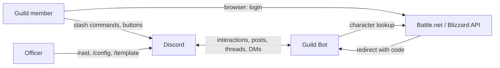
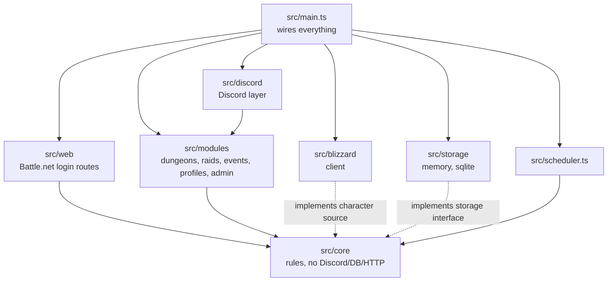
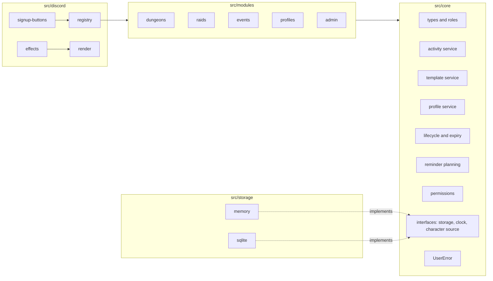
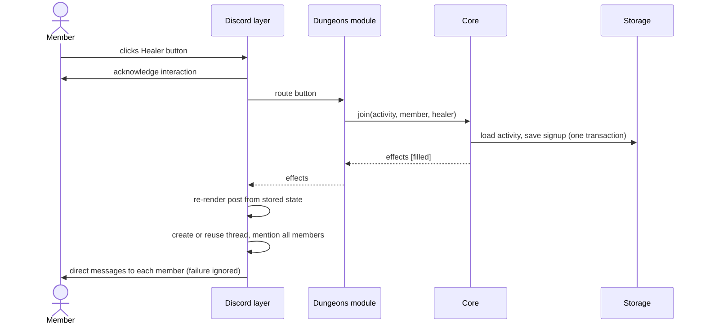
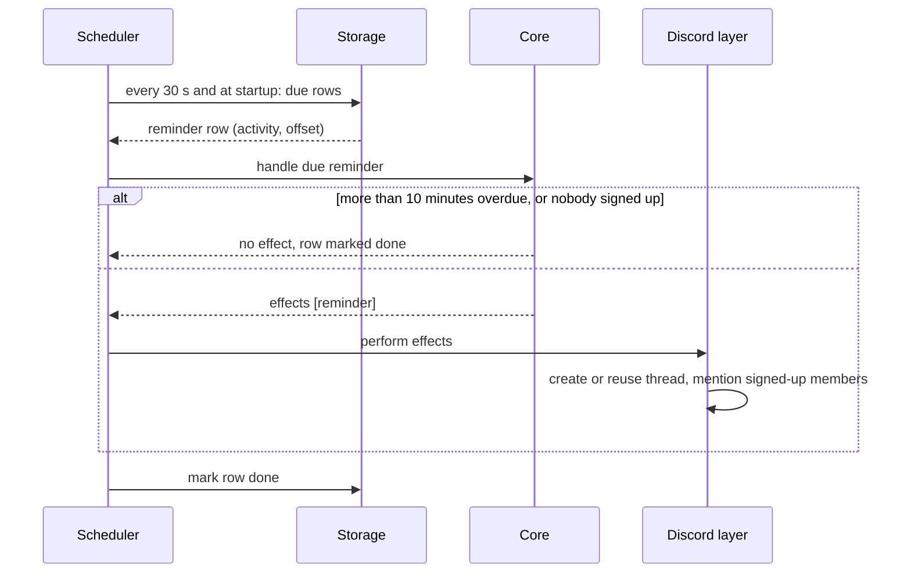
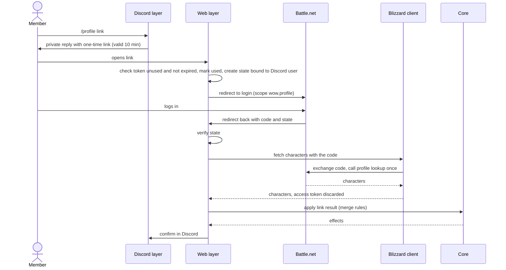
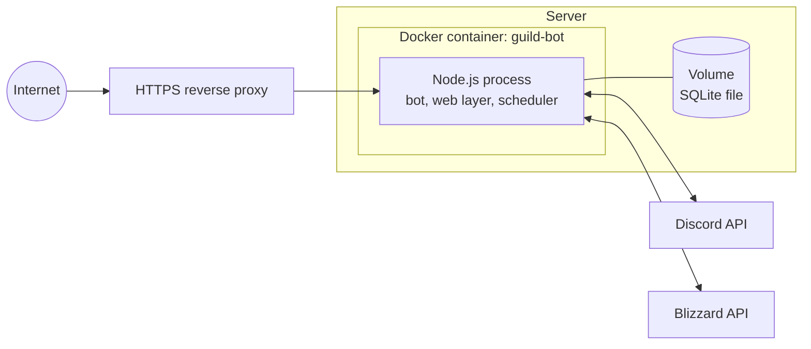

# Architecture: Guild Bot for WoW Forever

This document follows the arc42 template (12 sections). Requirements are in [req42](../requirements/req42.adoc). Items marked *(call)* were decided by the designer, not the project owner.

## 1. Introduction and Goals

### Requirements overview

A Discord bot for one World of Warcraft: Forever guild. It helps members find each other and play together:

- Dungeon finder: any member starts a group, others join by role, everyone is told when it is full.
- Raid finder: officers post raids, members sign up by role.
- Event planner: any member posts a free-form event.
- Character profiles: members link Battle.net to fetch their Forever characters, or enter them by hand.
- Officer commands for small, frequent changes (channels, officer roles, reminders, timezone, templates).

The full list is the product backlog in [req42 section 4](../requirements/req42.adoc).

### Quality goals

| Priority | Goal | Meaning |
|---|---|---|
| 1 | Changeability | New features are new modules. Rules live in a core that is tested without Discord. |
| 2 | Reliability of notifications | Full, promotion and reminder messages are not lost by a restart, a double click or a blocked direct message. |
| 3 | Privacy | Battle.net access tokens are never stored. Members can delete their data. Secrets stay in environment variables. |

### Stakeholders

| Stakeholder | Interest |
|---|---|
| Guild members | Quick group finding, clear notifications, optional profile. |
| Officers | Raids and small configuration changes from Discord. |
| Guild leadership | A bot that follows the guild's changing decisions. |
| Developer and maintainer | Easy extension, automated tests, simple deployment. |
| Blizzard, Discord | External platforms the bot depends on. |

## 2. Architecture Constraints

- Node.js 24 or newer, TypeScript (strict, ESM with NodeNext), discord.js 14, better-sqlite3, luxon, zod, Vitest, Docker, GitHub Actions. ESLint and Prettier for style *(call)*.
- `src/core` imports no Discord, database or HTTP library and no other `src/` folder. A module in `src/modules` never imports another module.
- The bot speaks English only. There is no translation layer.
- The Forever character lookup is unofficial and may change (see section 3). Group finding must not depend on it.
- Battle.net login needs a public HTTPS address. The bot itself does not terminate HTTPS.
- Secrets are only passed through environment variables, validated at startup.
- Fixed sets: roles are exactly tank, healer, dps, participant. Activity kinds are exactly dungeon, raid, event.
- Documents (req42, arc42) are written before code and updated with every feature.

## 3. Context and Scope

### Business context

| Partner | Exchange |
|---|---|
| Members and officers | Use Discord only. Open one web link when linking Battle.net. |
| Discord | Interactions in. Posts, edits, threads, mentions and direct messages out. |
| Battle.net / Blizzard | OAuth login, then one lookup of the member's Forever characters. |

### Technical context

| Interface | Technology | Notes |
|---|---|---|
| Discord | discord.js 14, gateway connection and REST | Every interaction is acknowledged before other work (3-second limit). |
| Web (login) | Node HTTP server, two routes: start login from a one-time link, and the return step | Public HTTPS address provided by a reverse proxy in front of the web port. |
| Blizzard | HTTPS: OAuth authorize and token, then `GET https://{region}.api.blizzard.com/profile/user/wow?namespace=profile-forever-{region}` | Scope `wow.profile`. Region is a setting, default `eu`. Unofficial for Forever. The access token is used once and discarded. |
| Database | SQLite file through better-sqlite3 | One file on a persistent volume. |

## 4. Solution Strategy

| Goal | Approach |
|---|---|
| Changeability | A core with all rules, feature modules that plug into a registry, thin outer layers (ADR-1). One generic activity with templates instead of one code path per kind (ADR-2). |
| Cheap Discord-side changes | Dungeon and raid lists, templates, reminders, channels and officer roles are data changed with officer commands. |
| Reliable notifications | Core methods return a list of effects; the Discord layer performs them. Reminders and closing are database rows checked by a scheduler (ADR-5). Changes to one activity are applied one at a time inside a transaction. Posts are re-rendered from stored state. |
| Testability | The core depends on interfaces (storage, clock, character source). Tests use in-memory storage, a fake clock and a fake character source. The SQLite storage is tested against a temporary file. |
| Privacy | No stored Battle.net tokens, one-time random links, state value bound to the Discord user, `/profile remove` deletes data (ADR-4). |
| Resilience to Blizzard changes | The Blizzard client is the only code that knows the lookup, and manual profiles are always possible (ADR-4). |

## 5. Building Block View

### Level 1: layers

Dependencies point inward: outer layers call modules and core, and the core knows only the interfaces it defines.

| Building block | Responsibility | Interfaces |
|---|---|---|
| `src/core` | Activities, templates, slots, signups, waitlist promotion, lifecycle, reminder planning, permission rules, profiles. Plain TypeScript. | Defines the storage, clock and character source interfaces. Methods return effects. |
| `src/modules` | Feature modules: dungeons, raids, events, profiles, admin. Each registers its commands, button handlers and post layout and calls the core. No module imports another. | Plugs into the registry in `src/discord`. |
| `src/discord` | discord.js. Routes slash commands, buttons, menus and forms to modules. Renders posts. Turns effects into posts, threads, mentions and direct messages. | Registry, render, effects, signup buttons. |
| `src/storage` | Implements the storage interface: in memory (tests) and SQLite with versioned migrations. | Storage interface of the core. |
| `src/web` | Minimal HTTP server: start Battle.net login from a one-time link, and handle the return. | Calls the core's profile rules. |
| `src/blizzard` | Implements the character source interface with the Forever lookup. | Character source interface of the core. |
| `src/scheduler.ts` | Loop every 30 seconds and at startup: finds due reminder and close rows and asks the core to handle them. | Core, clock. |
| `src/main.ts` | Reads and validates configuration, creates the parts and starts them. The only place that knows all the parts. | Environment variables. |

The core emits these **effects**: `filled`, `refilled`, `promoted`, `starterChanged`, `timeChanged`, `cancelled`, `reminder`, `closed`.

### Level 2: files

File and folder names inside the layers are the builder's choice; this is the plan and is updated when the code changes.

| Block | Content |
|---|---|
| core: activity service | Create activity, join, leave, switch role, set tentative or can't come, cancel, change time, hand over starter. Returns effects. |
| core: lifecycle and expiry | State changes open, full, finished, cancelled, expired. ASAP limit 2 hours, flexible limit 7 days, finished 3 hours after start (or after full if no time). |
| core: reminder planning | Chooses offsets (kind default, template override, copied onto the activity when posted) and the rows to schedule. Skips reminders more than 10 minutes overdue. |
| core: template service | Add, edit, disable templates. Roles come from the fixed set. |
| core: profile service | Link results, manual characters, merge rules, main character, removal. Uses the character source interface. |
| core: permissions | Who is an officer (configured roles, or server administrator). |
| core: errors | `UserError`: an error whose message a member should see. |
| discord: registry | Collects commands, button handlers and post layouts from modules. A new module is one registration line. |
| discord: render | Builds post content from stored state, so a failed edit can be retried. |
| discord: effects | Turns each effect into posts, thread creation and reuse, mentions and direct messages. |
| discord: signup-buttons | The shared role, leave, tentative and join buttons used by dungeons, raids and events. |
| storage: memory | In-memory implementation for tests. |
| storage: sqlite | SQLite implementation with migrations, transactions per activity, and the due-rows table for the scheduler. |

## 6. Runtime View

### Scenario 1: join a dungeon and fill it

If the role is full, the member goes on the waitlist and no `filled` effect is returned. When a member later leaves, the core promotes the first waitlisted member for that role and returns `promoted`; if the activity was full it is now open again, and when it fills again `refilled` produces a note in the thread only.

### Scenario 2: a reminder fires

The same loop handles automatic closing: expiry and finished rows produce a `closed` effect, and the Discord layer marks the post and removes its buttons.

### Scenario 3: Battle.net link

If the Battle.net account is already linked to another member, the link is refused with an explanation and nothing is stored. If the lookup fails, the member is told to use `/profile add`.

## 7. Deployment View

| Element | Notes |
|---|---|
| Docker container | One image, one process. Configuration only through environment variables (Discord token, Blizzard client id and secret, public base URL, region, database path). |
| Volume | Holds the SQLite file. It must be persistent and backed up; the deployment documentation includes a backup routine. |
| HTTPS | A reverse proxy or the hosting platform terminates HTTPS and forwards to the web port. Only the two login routes are served. |
| CI | GitHub Actions runs lint, type check and tests on every push. |

The specific host and the way HTTPS is terminated are left to the operator.

## 8. Cross-cutting Concepts

### Effects

Core methods do not talk to Discord. They change stored state and return a list of effects (`filled`, `refilled`, `promoted`, `starterChanged`, `timeChanged`, `cancelled`, `reminder`, `closed`). The Discord layer turns each effect into posts, thread messages, mentions and direct messages. This keeps rules testable without Discord and lets a new outer layer reuse them.

### UserError

Errors a member should see (for example "only officers can post raids", "could not read that time, try `today 20:30`") are thrown as `UserError` and shown as written. Every other error is logged and the member sees "Something went wrong." Every Discord interaction is acknowledged first, so the error is delivered as a follow-up.

### Serialised mutations

Changes to one activity are applied one at a time, inside a database transaction. Two simultaneous clicks on the last slot cannot overfill it: one succeeds, the other is waitlisted.

### Re-render from state

A post is always built from stored state and never patched incrementally. If an edit to Discord fails, the same render can be run again. The thread is created the first time it is needed and then reused.

### Secrets and tokens

Secrets come only from environment variables, validated at startup with zod. Battle.net access tokens are used once and never stored or logged. One-time links are random, single use and valid for 10 minutes. The login state value is bound to the Discord user.

### Time

Typed times are parsed in the guild's timezone (default Europe/Berlin) with luxon and shown with Discord timestamps. The core reads the time from a clock interface, so tests use a fake clock.

### Data as configuration

Dungeons, raids and templates are data (seed file, then officer commands). Reminder offsets are copied onto an activity when it is posted, so later changes do not affect posted activities.

## 9. Architecture Decisions

### ADR-1: Modular core with thin outer layers

- *Status:* accepted (owner's decision).
- *Context:* Changeability is the main quality goal. Features will be added by developers as the guild decides. Three approaches were considered:
  1. Simple feature folders: fastest first version, but rules get tangled with Discord's buttons and menus, features copy each other, and tests need a live Discord server.
  2. Modular core with Discord as a thin outer layer: about 20 to 30 percent more code up front.
  3. Approach 2 plus a web dashboard: nicer admin screens, but a second application with its own login and hosting, against the wish to keep Discord-side changes small.
- *Decision:* approach 2. A core with no Discord, database or HTTP imports; feature modules that plug into a registry and never import each other; thin Discord, web, Blizzard and storage layers.
- *Consequences:* a new feature is a new module plus one registration line. The core is tested automatically. A dashboard stays possible later as another outer layer. More code up front than approach 1.

### ADR-2: One generic activity with templates

- *Status:* accepted *(call)*.
- *Context:* Dungeon groups, raids and events share title, starter, time, slots, signups and lifecycle. They differ in who may start them, slots, extra signup states and reminders.
- *Decision:* a single activity model. A template (dungeon or raid) supplies the slot definition and optional reminder offsets. Events have no templates. Roles are a fixed set (tank, healer, dps, participant); templates choose counts, a new role is a code change. Reminder offsets are copied onto the activity when it is posted. Dungeon starters always take a slot; the starter hand-over rule applies only to dungeons.
- *Consequences:* waitlist, lifecycle and reminders are written once. A new kind of activity is a new module over the same core. Kind-specific rules stay in small, explicit places.

### ADR-3: SQLite behind an async storage interface

- *Status:* accepted *(call)*.
- *Context:* One guild, modest load, a single container. The core must be testable without a database.
- *Decision:* SQLite through better-sqlite3 with versioned migrations, behind a storage interface defined by the core. The interface is asynchronous so another database could replace SQLite without changing the core. An in-memory implementation is used in tests. Records carry a server id so multi-guild use is not ruled out; nothing is built for it.
- *Consequences:* no database server to run. The single file must be backed up. Moving to another database means writing one new storage implementation.

### ADR-4: No stored Battle.net tokens, with manual fallback

- *Status:* accepted.
- *Context:* The Forever lookup is unofficial. Members' accounts must not be put at risk, and group finding must not depend on Blizzard.
- *Decision:* the bot uses the access token once to read the member's characters, then discards it; tokens are never stored or logged. Profiles can always be entered by hand. A Battle.net account can be linked to one Discord member only *(call)*. The Blizzard region is a setting, default `eu` *(call)*. The Blizzard client is isolated behind a character source interface.
- *Consequences:* changing levels needs `/profile refresh` (a new login). If Blizzard changes the lookup, only the client changes and manual profiles keep working.

### ADR-5: Jobs in the database

- *Status:* accepted *(call)*.
- *Context:* Reminders and automatic closing must survive restarts.
- *Decision:* reminders and closing are rows with a due time in the database. A scheduler loop checks for due rows every 30 seconds and at startup. Reminders more than 10 minutes overdue at startup are skipped.
- *Consequences:* nothing is lost by a restart, and no in-memory timers have to be rebuilt. Timing accuracy is within about 30 seconds.

## 10. Quality Requirements

The quality scenarios are in [req42 section 6](../requirements/req42.adoc). In short: Q-1 and Q-2 (adding features and data without touching other modules), Q-3 (rules tested without Discord), Q-4 to Q-6 (reliable notifications), Q-7 (Blizzard changes), Q-8 (privacy), Q-9 (3-second acknowledgement).

## 11. Risks and Technical Debts

| Risk | Mitigation |
|---|---|
| Blizzard changes or withdraws the unofficial Forever lookup. | Manual profiles keep everything working. The Blizzard client is isolated behind one interface (ADR-4). |
| Discord changes its interaction interfaces. | The change is confined to the Discord layer. |
| The single SQLite file is lost. | The deployment documentation must include a backup routine. |
| The Blizzard secret was exposed during testing. | Regenerate it and update the redirect URL before going live. |
| Modules slowly start to depend on each other. | Add an automated import check to lint or tests that enforces the layer rules. |

Technical debt: none yet; no code exists.

## 12. Glossary

The terms (activity, template, slot, role, waitlist, starter, officer, main, surname, ASAP, flexible, effect, thread) are defined in [req42 section 8](../requirements/req42.adoc).
